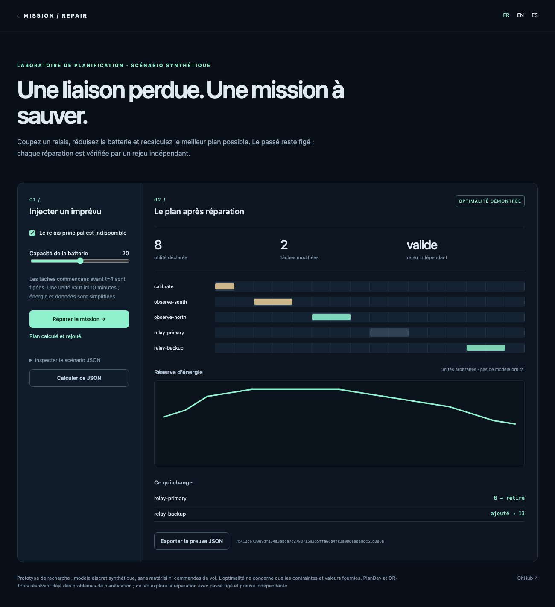

# Mission Intent Repair

[English](README.en.md) · [Español](README.es.md)

**Une liaison disparaît. Quel plan sauve le plus de valeur sans réécrire le passé ?**

Un laboratoire exécutable de réparation de missions, avec le vrai solveur OR-Tools CP-SAT, une interface locale et un vérificateur indépendant. Coupez le relais principal de la démonstration : le plan bascule sur le secours, conserve les deux tâches commencées et vérifie les réserves d’énergie et de stockage à chaque pas.



## Essayer en trois commandes

Python 3.11 ou supérieur ; aucune clé, aucun service distant.

```sh
python3 -m venv .venv
.venv/bin/pip install .
.venv/bin/python -m mission_repair serve --lang fr
```

Ouvrir `http://127.0.0.1:8764/?lang=fr`. Le scénario, les paramètres, le plan et la preuve JSON restent locaux. FR/EN/ES sont disponibles dans la même interface.

```sh
.venv/bin/python -m mission_repair demo --lang fr
.venv/bin/python -m mission_repair repair mission_repair/examples/lunar-relay.json
.venv/bin/python -m mission_repair check dossier.json plan.json
```

`check` accepte un objet `{ "task-id": start_tick }` ou un rapport contenant `plan`. Les codes d’erreur sont stables ; les messages CLI sont localisés avec `--lang`.

## Ce qui est calculé

- Fenêtres de début/fin, durées entières, dépendances et exclusivité des canaux.
- Batterie avec production solaire, consommation de base et tâches ; stockage avec production et déchargement en fin de tâche.
- Passé figé : toute tâche dont le début précédent est antérieur à `freeze_before` conserve exactement son début, y compris une tâche en cours.
- Objectif lexicographique : maximiser l’utilité déclarée, puis minimiser le nombre de tâches modifiées, puis leur déplacement temporel. Le coefficient 3000 dépasse le déplacement total possible dans les limites admises.
- Rejeu séparé du solveur : fenêtres, obligations, dépendances, collisions, batterie et stockage sont recalculés sans lire ses variables.
- Empreinte SHA-256 des hypothèses et détail des modifications ; export JSON rejouable.

Une panne du relais principal donne **8 unités d’utilité contre 10 avant panne**, avec **deux tâches modifiées**, sur le scénario synthétique fourni. Ce sont des valeurs définies par le scénario, pas des performances spatiales mesurées. Le plan ancien est invalide après la panne.

`OPTIMAL` signifie que les trois niveaux de l’objectif sont démontrés dans le modèle. `FEASIBLE` signifie qu’un plan vérifié existe sans preuve complète d’optimalité. `INFEASIBLE` indique une contradiction du modèle ; `required_conflict` est un ensemble suffisant d’obligations en conflit, **pas nécessairement minimal**. `UNKNOWN` conserve l’absence de résultat au lieu d’inventer une réussite.

## Modèle et limites

Au plus 30 tâches et 96 pas ; énergie et données sont des entiers arbitraires. La génération et la consommation sont agrégées par pas ; les changements de stockage simultanés sont agrégés à leur frontière. Une capacité réduite s’applique à tout l’horizon : pour une panne à une heure précise, fournir un nouvel horizon et son état initial, plutôt qu’une modification rétroactive.

Ce prototype ne calcule ni orbites, ni attitude, ni géométrie de visibilité. Les fenêtres sont fournies par l’utilisateur. Aucun matériel, simulateur de vol ou logiciel embarqué n’est connecté. Les résultats ne qualifient aucune mission réelle. Le solveur est limité en temps ; sa preuve concerne exclusivement les hypothèses saisies. Le serveur écoute sur la boucle locale et n’expose aucune commande de vol.

## Place dans l’écosystème

[PlanDev](https://nasa-ammos.github.io/plandev-docs/introduction/) fournit déjà modélisation, planification et contraintes de missions. [OR-Tools](https://developers.google.com/optimization/scheduling/job_shop) fournit déjà la résolution de problèmes de calendrier. Ce dépôt réutilise CP-SAT et se concentre sur une démonstration petite et autonome : **panne → passé figé → réparation optimale bornée → rejeu indépendant**. Il ne revendique aucune supériorité générale sur ces outils.

[Mission Benchmark Commons](https://github.com/gbesse/mission-benchmark-commons) compare des moteurs orbitaux ; [Contact Market](https://github.com/gbesse/contact-market) optimise des contacts. Ici, on répare le calendrier et les ressources autour d’une interruption ; ces dépôts ne sont pas copiés.

## Vérification

```sh
.venv/bin/python -m unittest discover -s tests -v
npm ci
npx playwright install chromium
PYTHON=.venv/bin/python npm run test:browser
npm run format:check
```

Les tests comprennent une comparaison exhaustive sur de petits problèmes, des pannes, des obligations impossibles, des ressources épuisées, le passé figé et l’export navigateur dans les trois langues. La CI vérifie aussi une roue Python installée hors de l’arbre source. Licence MIT ; alpha de recherche.
